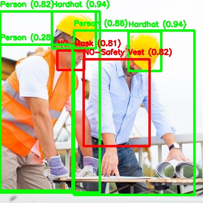
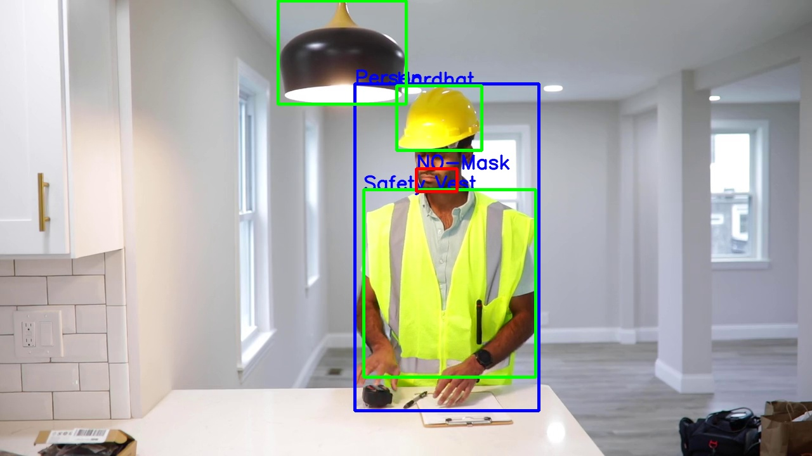

# Worker Gear Safety Detection

A computer vision system that checks whether construction workers are wearing the right protective gear. It uses a custom-trained **YOLOv8** model to detect hardhats, safety vests and masks in images and video, flags missing gear in red, and shows a summary on a simple **Streamlit** dashboard.

Built as my final-year major project for the BE in Computer Science at Brindavan College of Engineering, Bangalore (VTU).

<p align="center">
  
  
</p>

## What it does

- **Detects PPE and violations**: `Hardhat`, `Safety Vest`, `Mask`, `Gloves` and their absence (`NO-Hardhat`, `NO-Safety Vest`, `NO-Mask`)
- **Colour-coded output**: green for gear present, red for missing gear, blue for other objects
- **Site context**: also recognises people, safety cones, ladders, excavators, trucks and other site vehicles (25 classes in total)
- **Image and video input**: annotates uploaded images, or the first 30 frames of an uploaded video
- **Admin dashboard**: shows the annotated output and a count of each detected class
- **Email alerts (optional)**: can send the detection summary to an admin over SMTP

## How it works

1. The user uploads an image or video in the **Normal Interface**.
2. Each frame goes through the trained YOLOv8 model (`best.pt`).
3. Detections above 0.5 confidence are drawn on the frame and counted.
4. The **Admin Dashboard** displays the annotated result and the detection summary.

## Project structure

```
├── app.py              # Streamlit app: upload, detection, dashboard
├── helper.py           # Video writer and email summary helpers
├── best.pt             # Trained YOLOv8 weights (~84 MB)
├── requirements.txt
└── samples/            # Example outputs and a sample input video
```

## Getting started

Requires Python 3.10 or 3.11.

```bash
git clone https://github.com/AbhisriRavi/Worker-Gear-Safety-Detection.git
cd Worker-Gear-Safety-Detection
pip install -r requirements.txt
streamlit run app.py
```

Then open the URL Streamlit prints (usually http://localhost:8501), upload an image or `samples/sample_video.mp4`, and switch to the Admin Dashboard from the sidebar.

### Email alerts (optional)

The email feature is disabled by default (commented out in `app.py`). To use it, uncomment that block and set the sender credentials in `helper.py` and the recipient address in `app.py`.

## Tech stack

Python · YOLOv8 (Ultralytics) · PyTorch · OpenCV · Streamlit

## Author

**Abhisri Ravi**
